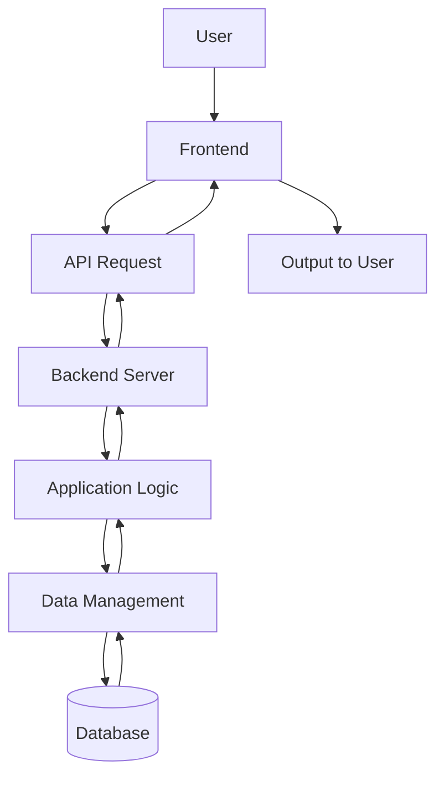

# Project Architecture

## Architecture Diagram

## Architecture Explanation

The user interacts with the frontend.

The frontend sends requests to the backend through APIs.

The backend processes the requests and manages application data.

The backend sends the response back to the frontend.

Finally, the frontend displays the result to the user.
